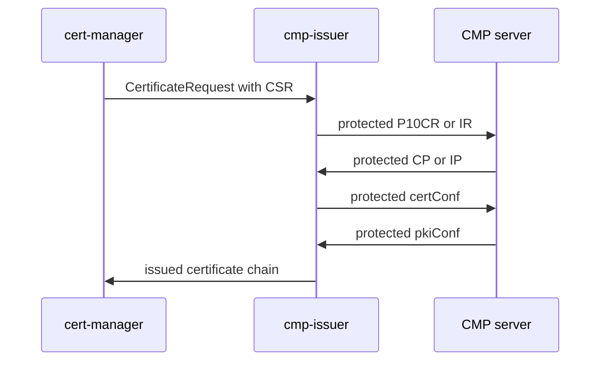

# Enrollment

Initial enrollment sends a protected P10CR with cert-manager's signed PKCS #10 CSR or a protected IR with a CRMF request built from that CSR. It completes when the server returns a validated CP or IP.

## Flow



When the server grants implicit confirmation the `certConf` / `pkiConf` exchange may be omitted.

## Prerequisites

1. cert-manager installed and approving requests
2. cmp-issuer controller Ready
3. Issuer credential and CMP trust Secrets readable
4. For `CMPIssuer`: the issuer namespace authorized for credential reads, see [Credential Secret access](../operations/secret-access.md)
5. CMP server profile allowing P10CR or IR with the chosen protection mode

## Configure the issuer

See [CMPIssuer](../reference/cmpissuer.md) or [CMPClusterIssuer](../reference/cmpclusterissuer.md). Set `protocol.initialEnrollment` to `P10CR` or `IR`.

| `initialEnrollment` | Request | Workload key access |
| --- | --- | --- |
| `P10CR` | cert-manager's signed CSR | None |
| `IR` | CRMF template with the CSR subject, public key and extensions. The staged private key signs proof of possession | The staged key of the `Certificate` |

IR builds its proof of possession with the private key cert-manager staged for revision one of a `Certificate`, so it needs a `CertificateRequest` that cert-manager created for that `Certificate`. A hand-written `CertificateRequest` fails before any CMP traffic. The issuer's own credentials protect the IR message, as they protect a P10CR. See [Private-key handling](private-key-handling.md#ir-one-narrowly-authorized-key-proof).

An issuer that enrolls with IR renews with KUR unless `protocol.renewal` says otherwise. See [Renewal with P10CR or KUR](renewal-and-kur.md).

## Request a certificate

```yaml
apiVersion: cert-manager.io/v1
kind: Certificate
metadata:
  name: workload-tls
spec:
  secretName: workload-tls
  issuerRef:
    name: my-cmp-issuer
    kind: CMPIssuer
    group: certmanager.misiektoja.github.io
  commonName: workload.example.com
  dnsNames:
    - workload.example.com
```

cert-manager creates a `CertificateRequest`. cmp-issuer reconciles it after approval. For ML-DSA, check the [build requirements and key usages](../known-limitations.md#ml-dsa).

## Inspect progress

```bash
kubectl describe certificaterequest <name>
kubectl get cmptransactions -n <namespace>
kubectl describe cmptransaction <name>
```

A `CMPTransaction` appears as soon as an enrollment starts and reports `Enrolling`, `Polling`, `Confirming` or `Issued`. It records the enrolled CSR digest, the issuer that served it and, once the server answers, the validated chain. It is removed with the `CertificateRequest` that owns it.

The controller log carries the same lifecycle as text. Each enrollment ends in one line naming the issuer, the endpoint, the CMP transaction and the issued certificate, and each wait, resumption and failure is logged as it happens. See [reading the controller log](../operations/troubleshooting.md#reading-the-controller-log).

## Requested validity

By default the CA chooses the validity of the certificate. With `protocol.requestedValidity: Duration` an IR or KUR asks for a `notAfter` of the transaction start plus the `CertificateRequest` `spec.duration`, which cert-manager copies from `Certificate.spec.duration`. A request without a duration asks for no validity.

```yaml
spec:
  protocol:
    initialEnrollment: IR
    requestedValidity: Duration
```

The CA decides the validity it grants and may shorten or ignore the request. A CA that replaces the requested validity may answer `grantedWithMods`, which fails the request under the default `policy.grantedModifications: Reject`. A PKCS #10 request cannot carry a validity, so P10CR never asks for one and `Duration` needs `initialEnrollment: IR` or `renewal: KUR`. See [how the tested servers answer](../interoperability/tested-pkis.md#certificate-validity).

## P10CR certReqId

RFC 9810 and RFC 9483 require `certReqId` `-1` in P10CR CP responses. Tested servers may return `0`. By default cmp-issuer accepts either value and echoes it in `certConf`. Pin a value with `spec.protocol.p10crResponseCertReqId` when needed.

## Confirmation hash

The `certConf` hash follows the issued certificate's signature algorithm. For a certificate signed with ML-DSA, `certConf` names SHA-512 in `hashAlg`, which RFC 9810 section 5.3.18 allows only in CMPv3, so that `certConf` is sent as CMPv3. A CMPv2 or CMPv3 answer to it is accepted.

## Granted modifications

When `spec.policy.grantedModifications` is `Reject`, certificates issued with `grantedWithMods` fail. Unless the server granted implicit confirmation, cmp-issuer also rejects them in `certConf`. Set `Accept` only when server-side field changes are expected and acceptable.

## Asynchronous enrollment

Servers that answer `waiting` trigger polling until a certificate arrives or limits expire. See [Transaction recovery](transaction-recovery.md).

## Related pages

* [Message protection](message-protection.md)
* [Tested PKIs](../interoperability/tested-pkis.md)
* [Troubleshooting](../operations/troubleshooting.md)
